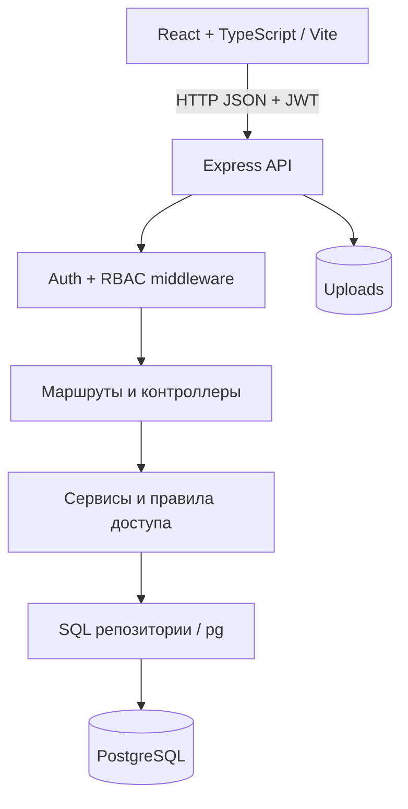
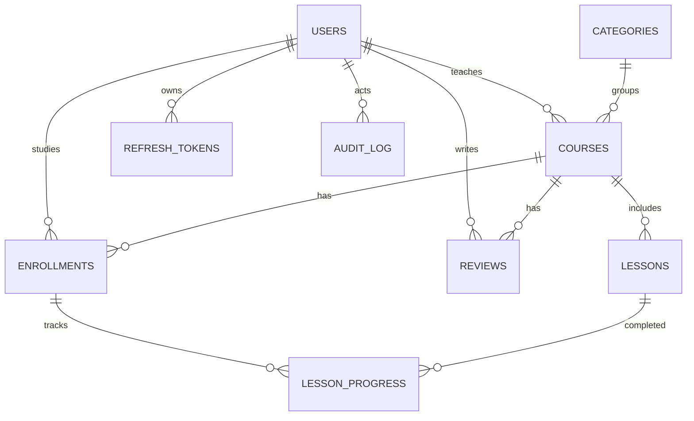

# Архитектура Forma

## Таблицы и связи

Ключевые бизнес-правила: публиковать курсы может только модератор; редактировать — автор или модератор; студент видит только свой прогресс; отзыв доступен только после записи на курс. Пароли хранятся в bcrypt, refresh-токены — в SHA-256.
